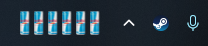

# RedBull Tracker

A Windows taskbar widget to track your Red Bull consumption.



## Features

- **Visual tracking**: one can per Red Bull in stock, right on the taskbar
- **Modern Windows 11 look**: crisp Direct2D rendering, cans lift when you hover them, smooth tooltips
- **Offline or synced**: keep a local count, or sync stock with the Red Bull Tracker API (`apps/api`)
- **Tiny**: a single ~2 MB native exe, a few MB of memory, no CPU while idle
- **Plays nicely with other widgets**: drag to reorder; widgets never overlap or jump around

## Installation

1. Download `RedBullTracker-vX.Y.Z-win-x64.exe` from [Releases](https://github.com/DrDraxi/redbull-tracker/releases)
2. Run it. The widget appears next to the system tray. No installer or .NET runtime needed.

## Usage

- **Left-click a can** to drink it
- **Right-click** to add a can (offline mode)
- **Shift+right-click** for the menu: settings, start with Windows, exit (in API mode a plain right-click opens it)
- **Drag** the widget to reorder it among other taskbar widgets
- **Hover** for counts per can type

## Configuration

Configuration is stored in `%LOCALAPPDATA%\RedBullTracker\config.json` (menu → *Edit settings…*):

```json
{
  "canType": "default",
  "apiUrl": null,
  "apiToken": null,
  "startWithWindows": true
}
```

| Option | Description | Values |
|--------|-------------|--------|
| `canType` | Can image used in offline mode | `"default"`, `"sugarfree"` |
| `apiUrl` | Red Bull Tracker API base URL. When set, the widget syncs stock every 5 s | URL or `null` |
| `apiToken` | Bearer token for the API (required with `apiUrl`) | string or `null` |
| `startWithWindows` | Launch on Windows startup | `true`, `false` |

The `REDBULL_API_URL` and `REDBULL_API_TOKEN` environment variables override the file.

## Building from Source

This is a monorepo. The widget lives in `apps/widget/`; the API lives in `apps/api/`.

```bash
# Clone with submodules
git clone --recursive https://github.com/DrDraxi/redbull-tracker.git
cd redbull-tracker

# Build
dotnet build -p:Platform=x64

# Run
dotnet run --project apps/widget/RedBullTracker.csproj -p:Platform=x64
```

## Requirements

- Windows 10/11
- Nothing at runtime. The release exe is native (NativeAOT). Building needs the .NET 10 SDK.

## License

MIT
